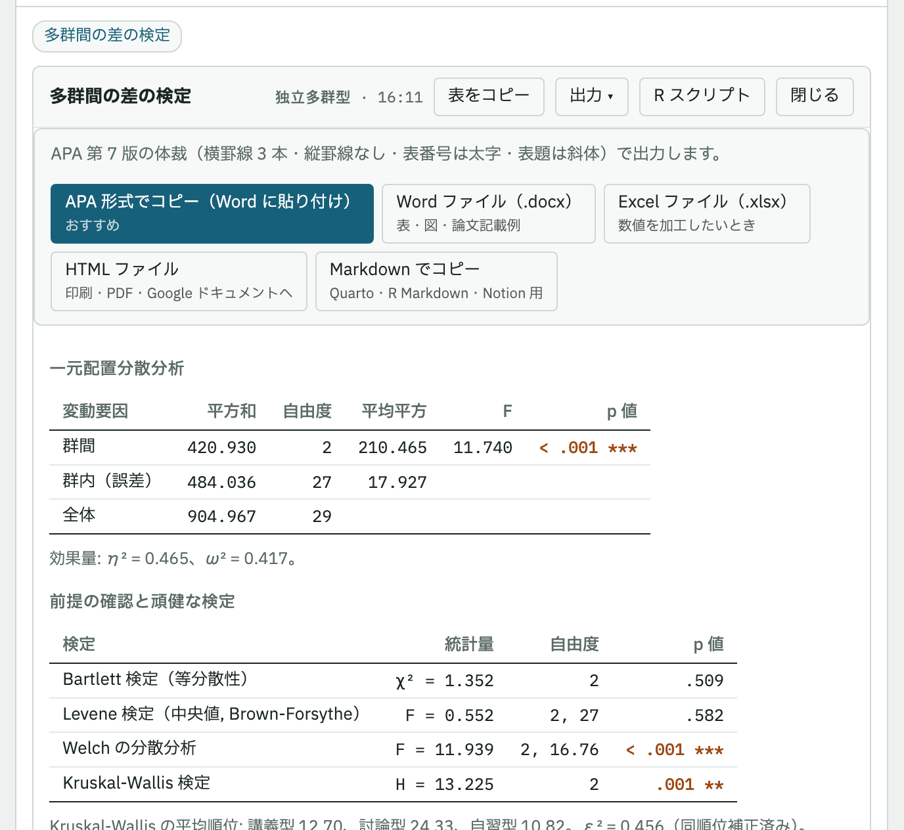
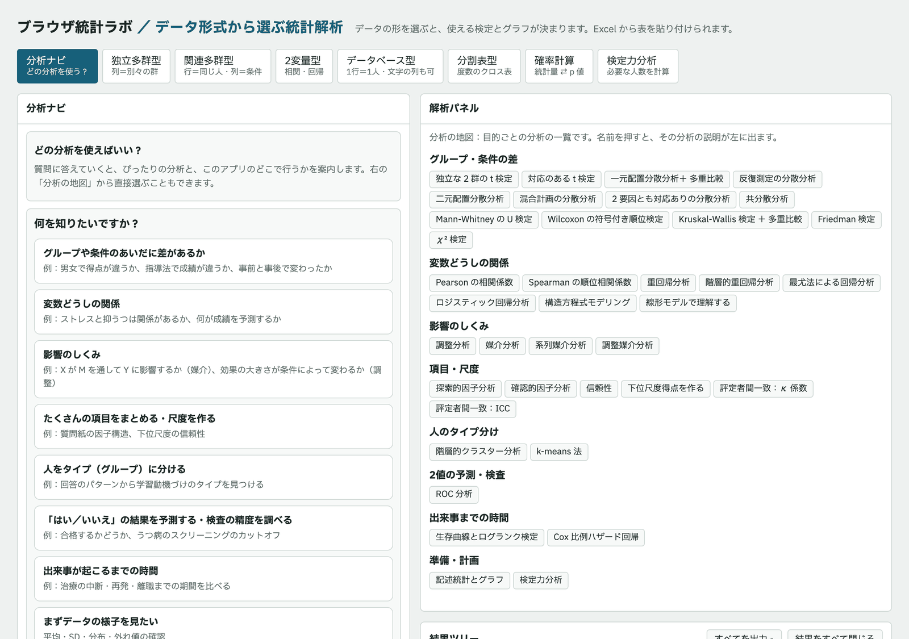
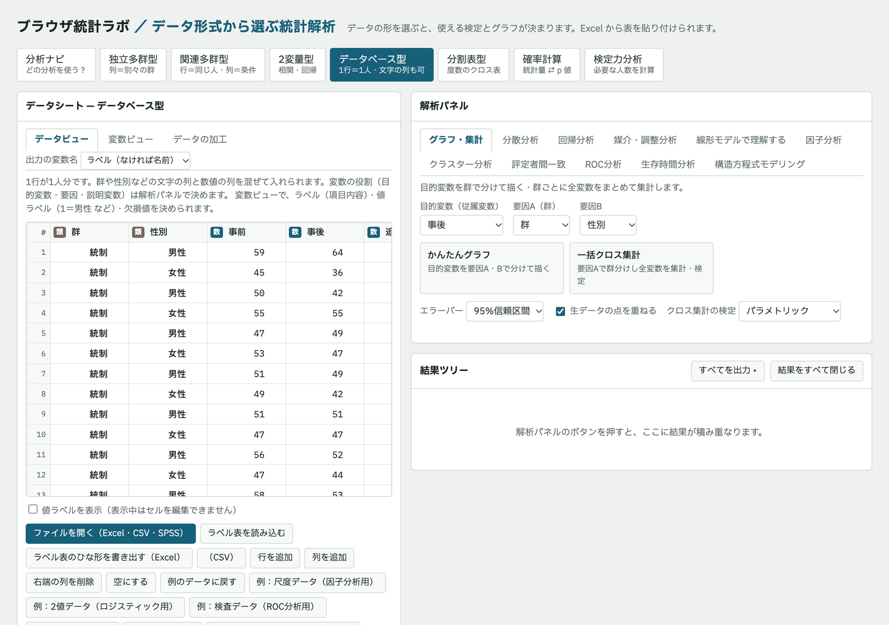

# ブラウザ統計ラボ

ブラウザだけで動く、心理学・教育研究向けの統計ソフトです。インストールは不要で、HTML ファイル 1 つで動きます。

**使ってみる → https://hiroue80x.github.io/browser-stat-lab/**

## 特徴

- **データの形式から解析を選べる**：独立多群型・関連多群型・2 変量型・データベース型（1 行 ＝ 1 人）・分割表型・確率計算・検定力分析。「分析ナビ」で目的から解析を探すこともできます。
- **APA 第 7 版の表で出力**：Word への貼り付け、docx・xlsx・HTML・Markdown での保存ができます。
- **R との連携**：解析と同じ内容の R スクリプトを書き出せます。
- **Excel・CSV・SPSS（.sav）のデータを読み込める**：CSV は UTF-8 と Shift_JIS（Windows の Excel で保存したもの）のどちらでも読み込めます。
- **数値は R で照合済み**：主な解析の結果は、R（lavaan、survival、pROC、multcomp、emmeans など）の結果と照合しています。

## データの扱い（プライバシー）

- 入力したデータは**どこにも送信されません**。計算はすべて、あなたのブラウザの中で行われます。
- 作業内容は、そのブラウザの保存領域（localStorage）にだけ保存されます。共用のパソコンで使ったあとは、ブラウザの閲覧データを消去してください。
- 外部から読み込むのは、表示用のフォント（Google Fonts）だけです。オフラインでも、Windows・Mac に入っているフォントで動きます。

## 使い方

上のリンクを開くと、そのまま使えます。オフラインで使いたいときは、このリポジトリの `index.html` をダウンロードして、ブラウザ（Chrome・Edge・Safari・Firefox）で開いてください。Windows・Mac のどちらでも使えます。

### 1. データの形を選んで、データを入れる

画面の上のタブで、データの形（独立多群型・関連多群型・2 変量型など）を選びます。左のデータシートに数値を入力するか、Excel で範囲をコピーしてセルに貼り付けます。最初は例のデータが入っているので、そのまま試せます。

**ファイルから読み込むこともできます。** データシートの上の「ファイルを開く（Excel・CSV・SPSS）」で、1 行 ＝ 1 人の形のファイルを 1 つ読み込みます。あとは、どのタブでも使う列を選んで「データシートに並べる」を押すだけです。

- 独立多群型：測定値の列と群の列を選ぶと、群ごとの列に分けて並べます。
- 関連多群型：条件・時点の列を選びます。
- 2 変量型：X と Y の列を選びます。
- 分割表型：カテゴリの列を 2 つ選ぶと、クロス表を作ります。

読み込んだデータは、データベース型タブのデータと共通です。

### 2. 解析パネルのボタンを押す

右上の解析パネルで、使いたい解析のボタンを押します。結果は右下の「結果ツリー」に、APA 第 7 版の体裁の表として積み重なっていきます。


### 3. 結果を Word などに出力する

結果の右上の「出力」から、Word への貼り付け（APA 形式でコピー）や、Word・Excel・HTML ファイルでの保存ができます。「R スクリプト」を押すと、同じ解析を R で行うためのコードが表示されます。



### どの分析を使えばよいか迷ったら：分析ナビ

「分析ナビ」のタブでは、「グループのあいだに差があるか」「変数どうしの関係」など、知りたいことから分析を探せます。右側は、このアプリでできる分析の一覧です。



### 1 行 ＝ 1 人のデータ：データベース型

性別や群などの文字の列を含むデータは「データベース型」で扱います。「ファイルを開く」から Excel・CSV・SPSS（.sav）のファイルを読み込めます。回帰分析・因子分析・媒介分析・構造方程式モデリングなどは、こちらのタブから使います。



書き出した CSV には BOM を付けているので、Windows の Excel で開いても文字化けしません。

画像の数値は、アプリに入っている例のデータ（架空のデータ）によるものです。

## ソースからの組み立て

`src/` の各ファイルを、`build.sh` が 1 つの `index.html` にまとめます（Node.js が必要です）。

```sh
sh build.sh
```

## 注意

- 教育・研究の補助を目的としたソフトです。論文などで使う場合は、R などの統計ソフトでも結果を確かめることをおすすめします。
- 本ソフトは無保証です（LICENSE をご覧ください）。

## ライセンス

[MIT License](LICENSE)
