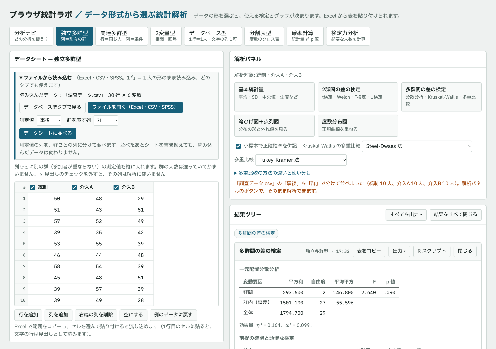
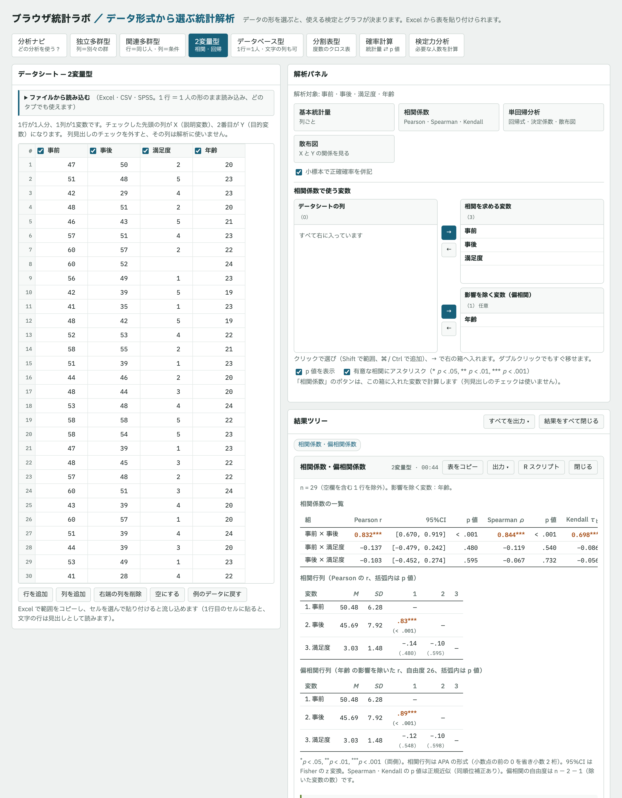
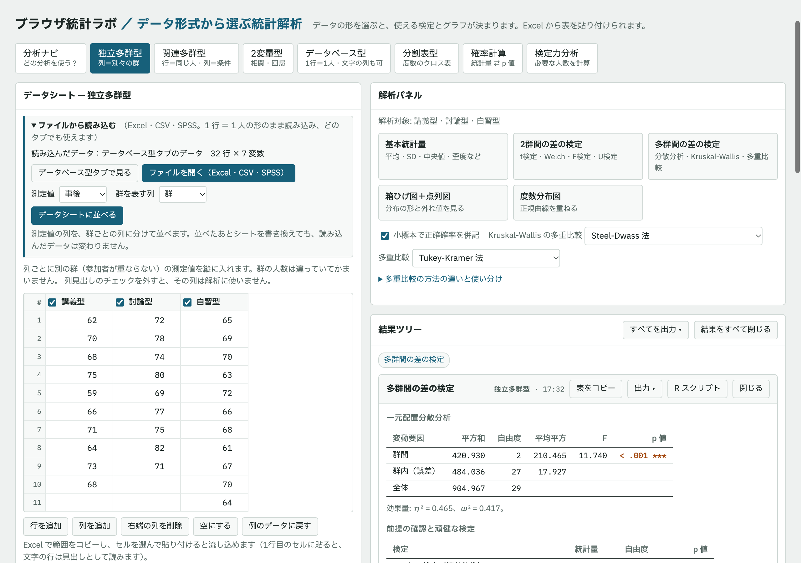

# ブラウザ統計ラボ

ブラウザだけで動く、心理学・教育研究向けの統計ソフトです。インストールは不要で、HTML ファイル 1 つで動きます。

**使ってみる → https://hiroue80x.github.io/browser-stat-lab/**

## 特徴

- **データの形式から解析を選べる**：独立多群型・関連多群型・2 変量型・データベース型（1 行 ＝ 1 人）・分割表型・確率計算・検定力分析。「分析ナビ」で目的から解析を探すこともできます。
- **APA 第 7 版の表で出力**：Word への貼り付け、docx・xlsx・HTML・Markdown での保存ができます。
- **R との連携**：解析と同じ内容の R スクリプトを書き出せます。
- **Excel・CSV・SPSS（.sav）のデータを読み込める**：1 つのファイルを読み込めば、どのタブでも使う列を選ぶだけで解析できます。CSV は UTF-8 と Shift_JIS（Windows の Excel で保存したもの）のどちらでも読み込めます。
- **数値は R で照合済み**：主な解析の結果は、R（lavaan、survival、pROC、multcomp、emmeans など）の結果と照合しています。

## データの扱い（プライバシー）

- 入力したデータは**どこにも送信されません**。計算はすべて、あなたのブラウザの中で行われます。
- 作業内容は、そのブラウザの保存領域（localStorage）にだけ保存されます。共用のパソコンで使ったあとは、ブラウザの閲覧データを消去してください。
- 「解析の自動記録」と「R の作業フォルダ」は、**あなたが選んだパソコンの中のフォルダ**にだけファイルを書き込みます。
- 外部から読み込むのは、表示用のフォント（Google Fonts）だけです。オフラインでも、Windows・Mac に入っているフォントで動きます。

## 使い方

上のリンクを開くと、そのまま使えます。オフラインで使いたいときは、このリポジトリの `index.html` をダウンロードして、ブラウザ（Chrome・Edge・Safari・Firefox）で開いてください。Windows・Mac のどちらでも使えます。

### 0. はじめの設定（初めて開いたとき）

初めて開くと「はじめの設定」の画面が出て、次の 3 つを順番に案内します。あとからでも、画面の上の「はじめの設定」ボタンでやり直せます。

1. **データを読み込む**：Excel・CSV・SPSS のファイルを選びます。「まず練習用のデータで試す」で、例の尺度データを入れることもできます。
2. **結果を保存するフォルダ**：研究名を入れて、解析の記録を保存するフォルダを選びます（下の「解析の自動記録」）。
3. **R の作業フォルダ**：「RStudio 用に書き出す」でデータと R スクリプトを書き出すフォルダを選びます。

研究ごとに「データ」「結果」「R」のフォルダを分けておくと、あとで迷いません。②と③には別のフォルダを選んでください。どちらも「今はしない」でとばせます。

> フォルダを選ぶ機能は、**Chrome か Edge** で使えます（Safari・Firefox では、この 2 つの手順をとばして使います）。

### 1. データの形を選んで、データを入れる

画面の上のタブで、データの形（独立多群型・関連多群型・2 変量型など）を選びます。左のデータシートに数値を入力するか、Excel で範囲をコピーしてセルに貼り付けます。最初は例のデータが入っているので、そのまま試せます。

#### ファイルから読み込む

データシートの上の「ファイルから読み込む」の欄にある「ファイルを開く（Excel・CSV・SPSS）」で、1 行 ＝ 1 人の形のファイルを 1 つ読み込みます（ファイルをデータシートにドラッグしても読み込めます）。あとは、どのタブでも使う列を選んで「データシートに並べる」を押すだけです。

- 独立多群型：測定値の列と群の列を選ぶと、群ごとの列に分けて並べます。
- 関連多群型：条件・時点の列を選びます。
- 2 変量型：並べる列を選びます（1 番目が X、2 番目が Y）。
- 分割表型：カテゴリの列を 2 つ選ぶと、クロス表を作ります。

読み込んだデータは、データベース型タブのデータと共通です。データベース型タブで決めた欠損値・値ラベル・ケースの選択も、そのまま使われます。並べたあとでデータシートを書き換えても、読み込んだデータは変わりません。



### 2. 解析パネルのボタンを押す

右上の解析パネルで、使いたい解析のボタンを押します。結果は右下の「結果ツリー」に、APA 第 7 版の体裁の表として積み重なっていきます。

2 変量型の「相関係数」では、解析パネルの下の箱で変数を選びます。左の一覧から「相関を求める変数」の箱へ入れると、相関係数の一覧と相関行列（APA の形式、平均・SD つき）が出ます。「影響を除く変数（偏相関）」の箱に変数を入れると、その影響を除いた偏相関係数も出します。「p 値を表示」と「有意な相関にアスタリスク（* p < .05, ** p < .01, *** p < .001）」は、チェックで切り替えられます。





### 3. 結果を Word などに出力する

結果の右上の「出力」から、Word への貼り付け（APA 形式でコピー）や、Word・Excel・HTML ファイルでの保存ができます。「R スクリプト」を押すと、同じ解析を R で行うためのコードが表示されます。


### どの分析を使えばよいか迷ったら：分析ナビ

「分析ナビ」のタブでは、「グループのあいだに差があるか」「変数どうしの関係」など、知りたいことから分析を探せます。右側は、このアプリでできる分析の一覧です。


### 1 行 ＝ 1 人のデータ：データベース型

性別や群などの文字の列を含むデータは「データベース型」で扱います。「ファイルを開く」から Excel・CSV・SPSS（.sav）のファイルを読み込めます。回帰分析・因子分析・媒介分析・構造方程式モデリングなどは、こちらのタブから使います。


#### 変数の型を変える

データビューの列名の下にある小さな印（数＝数値、類＝文字・カテゴリ、日＝日付）を押すと、その列の型を「数値・文字・日付・自動」から選べます。変数ビューの「型」の欄でも変えられます。

尺度の項目なのに「類」と表示されて因子分析などの一覧に出てこないときは、たいてい「.」「NA」「3 点」のような**数字でない値**がまざっています。アプリはそれを見つけて変数ビューに ⚠ で知らせ、どの値が何件あるかを示します。「欠損値にする」を押すとそれらを欠損値に指定し、「型を「数値」にする」を押すと数字でない値を空欄として扱います。

#### 因子分析：ポリコリック相関

リッカート法（「1 あてはまらない 〜 5 あてはまる」など）の項目は、順序のある段階のデータです。因子分析の「相関」で次の 3 つから選べます。

- **ピアソン（通常）**
- **ポリコリック（順序尺度）**：段階の背後に連続した量を仮定して相関を推定します（R の psych::polychoric と同じ計算で、結果を照合済み）。
- **ポリコリックと通常を比較**：同じ設定で両方の因子分析を行い、因子負荷量を並べて差を示します。因子ごとのタッカーの一致係数（.95 以上なら実質的に同じ）、適合度、因子間相関、所属する因子が変わった項目も示します。

ポリコリック相関のときの χ² と RMSEA は参考値です。α 係数と ω 係数は、もとの得点から計算します。

#### 構造方程式モデリング：パーセリングと図の文字の大きさ

パス図エディタでは、いくつかの項目の平均を 1 つの指標（パーセル）にまとめられます。パーセルの分け方は、内容（下位尺度）に基づく手動の割り当て・バランス法（因子負荷がそろうように配る；Little et al., 2002）・項目の順に交互に配る方法・無作為配分から選べます。無作為に分けたときは、分け方を何通りも変えて推定し直し、結果のばらつきを確かめられます。図の文字の大きさや、潜在変数・観測変数の図形の大きさも変えられます。

### 解析の自動記録

結果の上の「自動記録」で研究名と保存するフォルダを決めておくと、解析を実行するたびに、次のものをそのフォルダに自動で保存します。

- 解析の出力（HTML）
- 同じ解析を行う R スクリプト
- そのときのデータ（CSV）と値ラベルの表（データが変わっていなければ、前のものを使い回します）

ファイル名は「FMS研究_因子分析5因子モデル_36項目使用_202611271904」のように、研究名・解析の内容・使った項目の数・日時がわかる形になります。フォルダの中の **解析記録一覧.html** を開くと、これまでの解析が一覧になり、それぞれの出力・R スクリプト・データを開けます（解析記録.csv も作ります）。「どのデータで、何を、どう分析したか」をあとからたどれるので、卒業論文や論文の作業記録として使えます。

```
結果/（選んだフォルダ）
├ 解析記録一覧.html
├ 解析記録.json ・ 解析記録.csv
├ 出力/  …… 解析ごとの出力
├ R/     …… 解析ごとの R スクリプト
└ データ/ …… そのときのデータとラベル表
```

書き出した CSV には BOM を付けているので、Windows の Excel で開いても文字化けしません。

画像の数値は、アプリに入っている例のデータ（架空のデータ）によるものです。

## ソースからの組み立て

`src/` の各ファイルを、`build.sh` が 1 つの `index.html` にまとめます（Node.js が必要です）。

```sh
sh build.sh
```

## 注意

- 教育・研究の補助を目的としたソフトです。論文などで使う場合は、R などの統計ソフトでも結果を確かめることをおすすめします。
- 本ソフトは無保証です（LICENSE をご覧ください）。

## ライセンス

[MIT License](LICENSE)
